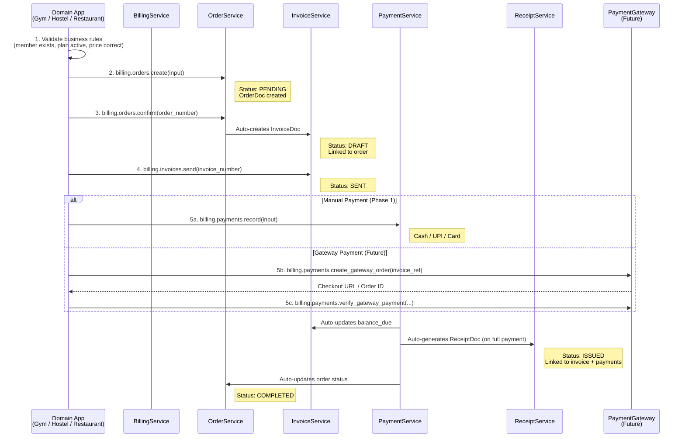
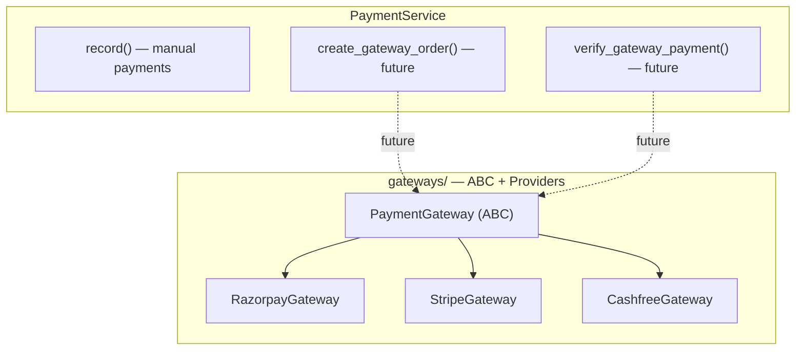

# Billing Service — OOP SDK Architecture Redesign

Redesign the billing module into a class-based, ABC-driven billing SDK with a facade pattern. Domain apps (gym, hostel, restaurant) import and use billing like a third-party library.

---

## Billing Lifecycle — The Full Flow



### Where Each Responsibility Lives

| Responsibility | Owner | Why |
|:---|:---|:---|
| Item validation | **Domain App** | Only gym knows if plan "GYM_PRO" exists |
| Pricing logic | **Domain App** | Only gym knows the price of plan "GYM_PRO" |
| Discount rules | **Domain App** | Only gym knows "10% off for annual members" |
| Inventory/membership validation | **Domain App** | Domain-specific business rules |
| **Order creation** | **Billing** | Unified pre-invoice staging with lifecycle tracking |
| **Invoice generation** | **Billing** | Number, totals, tax computation |
| **Payment capture** | **Billing** | Record payment, update invoice balance |
| **Receipt generation** | **Billing** | Auto-generated proof of payment |
| **Refunds / credit notes** | **Billing** | Credit note against invoice, balance adjustment |
| **Tax computation** | **Billing** | GST: CGST/SGST vs IGST |
| **Audit trail** | **Billing** | Who did what, when |
| **Gateway integration** | **Billing** (future) | Razorpay, Stripe, Cashfree abstraction |

> [!IMPORTANT]
> **Backward Compatibility**: Domain apps can still call `billing.invoices.create()` directly (skipping orders) for simple flows. Orders are optional but recommended for full lifecycle tracking.

---

## SDK Usage Pattern

```python
# ── Import billing like a third-party SDK ─────────────────────────
from app.modules.billing import (
    BillingService,
    CreateOrderInput,
    CreateInvoiceInput,
    RecordPaymentInput,
    IssueCreditNoteInput,
    ServiceLineItem,
    GoodsLineItem,
    CustomerRefSchema,
)

# ── Instantiate once per request ──────────────────────────────────
billing = BillingService(db, ctx)

# ── Full lifecycle flow ───────────────────────────────────────────

# 1. Create order (pre-invoice staging)
order = await billing.orders.create(CreateOrderInput(
    customer_ref=CustomerRefSchema(ref_type="member", ref_id="M-1", name="Alice"),
    line_items=[ServiceLineItem(item_type="service", description="Pro Gym - Monthly", ...)],
    seller_gstin="29AABCU9603R1ZM",
    source_ref={"app": "myGym", "ref_type": "subscription", "ref_id": "SUB-001"},
))

# 2. Confirm order → auto-creates invoice
order, invoice = await billing.orders.confirm(order.order_number)

# 3. Send invoice (draft → sent)
invoice = await billing.invoices.send(invoice.invoice_number)

# 4. Record payment (manual — Phase 1)
payment = await billing.payments.record(RecordPaymentInput(
    invoice_ref=invoice.invoice_number,
    amount=5000.0,
    method="upi",
    transaction_ref="UPI-TXN-123456",
))
# → Invoice auto-updated to PAID
# → Receipt auto-generated
# → Order auto-updated to COMPLETED

# 5. Get receipt
receipt = await billing.receipts.get_for_invoice(invoice.invoice_number)

# ── Direct invoice (skip order — backward compatible) ─────────────
invoice = await billing.invoices.create(CreateInvoiceInput(...))

# ── Refund ────────────────────────────────────────────────────────
credit_note = await billing.credit_notes.issue(IssueCreditNoteInput(
    invoice_ref="INV/2026-27/0001",
    reason="Partial refund — overcharged",
    refund_amount=1000.0,
))
credit_note = await billing.credit_notes.apply("CN/2026-27/0001")

# ── Future: Gateway payment ──────────────────────────────────────
# gateway_order = await billing.payments.create_gateway_order("INV/2026-27/0001")
# verified = await billing.payments.verify_gateway_payment(payment_id, order_id, signature)
```

---

## Class Hierarchy

### ABC Contract

```python
class BaseBillingService(ABC):
    """
    Abstract base for all billing service domains.

    Provides shared infrastructure: database access, org context,
    structured logging, and billing number generation.
    
    Every billing sub-service MUST inherit this class and implement
    the abstract properties.
    """

    def __init__(self, db: AsyncIOMotorDatabase, ctx: OrgContext) -> None:
        self._db = db
        self._ctx = ctx
        self._logger = create_logger(f"billing.{self.service_name}")

    @property
    @abstractmethod
    def service_name(self) -> str:
        """Unique identifier for logging and tracing."""
        ...

    @property
    @abstractmethod
    def entity_type(self) -> str:
        """The _meta.entity_type this service manages."""
        ...

    @property
    def number_prefix(self) -> str:
        """
        Prefix for auto-numbered documents (e.g., 'INV', 'PAY', 'ORD').
        Override in subclasses. Returns '' by default (no auto-numbering).
        """
        return ""

    async def _generate_number(self) -> str:
        """
        Generate next sequential number: {prefix}/{FY}/{counter:04d}.
        Uses shared sequence_helpers for atomic org-scoped counters.
        """
        if not self.number_prefix:
            raise NotImplementedError(
                f"{self.service_name} does not support auto-numbering."
            )
        return await generate_billing_number(
            self._db, self._ctx,
            prefix=self.number_prefix,
            entity_key=self.entity_type,
        )
```

### Service Implementations

| Service | `service_name` | `entity_type` | `number_prefix` | Public Methods |
|:---|:---|:---|:---|:---|
| `OrderService` | `"orders"` | `"order"` | `"ORD"` | `create`, `confirm`, `cancel`, `get`, `list` |
| `InvoiceService` | `"invoices"` | `"invoice"` | `"INV"` | `create`, `get`, `update`, `send`, `void`, `list`, `apply_payment` |
| `PaymentService` | `"payments"` | `"payment"` | `"PAY"` | `record`, `get`, `list`, `list_for_invoice` |
| `CreditNoteService` | `"credit_notes"` | `"credit_note"` | `"CN"` | `issue`, `apply`, `void`, `get`, `list` |
| `ReceiptService` | `"receipts"` | `"receipt"` | `"RCT"` | `get`, `get_for_invoice`, `list` (read-only, auto-generated) |
| `TaxProfileService` | `"tax_profiles"` | `"tax_profile"` | `""` | `create`, `update`, `get_default`, `list`, `preview` |

### Facade

```python
class BillingService:
    """
    Unified billing SDK — the single entry point for all billing operations.

    Composes sub-services into a clean, discoverable interface.
    Sub-services are lazy-initialized on first access.
    """

    __slots__ = ("_db", "_ctx", "_orders", "_invoices", "_payments",
                 "_credit_notes", "_receipts", "_tax_profiles")

    def __init__(self, db: AsyncIOMotorDatabase, ctx: OrgContext) -> None:
        self._db = db
        self._ctx = ctx
        self._orders: OrderService | None = None
        self._invoices: InvoiceService | None = None
        self._payments: PaymentService | None = None
        self._credit_notes: CreditNoteService | None = None
        self._receipts: ReceiptService | None = None
        self._tax_profiles: TaxProfileService | None = None

    @property
    def orders(self) -> OrderService:
        """Order lifecycle: create, confirm, cancel, get, list."""
        if self._orders is None:
            self._orders = OrderService(self._db, self._ctx)
        return self._orders

    @property
    def invoices(self) -> InvoiceService:
        """Invoice lifecycle: create, send, void, list, get."""
        if self._invoices is None:
            self._invoices = InvoiceService(self._db, self._ctx)
        return self._invoices

    @property
    def payments(self) -> PaymentService:
        """Payment recording: record, list, get."""
        if self._payments is None:
            self._payments = PaymentService(self._db, self._ctx)
        return self._payments

    @property
    def credit_notes(self) -> CreditNoteService:
        """Refund & credit notes: issue, apply, void, list, get."""
        if self._credit_notes is None:
            self._credit_notes = CreditNoteService(self._db, self._ctx)
        return self._credit_notes

    @property
    def receipts(self) -> ReceiptService:
        """Receipts: get, list (read-only — auto-generated on full payment)."""
        if self._receipts is None:
            self._receipts = ReceiptService(self._db, self._ctx)
        return self._receipts

    @property
    def tax_profiles(self) -> TaxProfileService:
        """Tax profile management: create, update, list, preview."""
        if self._tax_profiles is None:
            self._tax_profiles = TaxProfileService(self._db, self._ctx)
        return self._tax_profiles
```

---

## Payment Gateway Abstraction (Future-Ready)

The gateway directory is designed now but implemented later. The abstraction ensures adding Razorpay, Stripe, or Cashfree is a plug-in operation — no billing service changes needed.



### Gateway ABC (designed now, implemented later)

```python
# gateways/base.py — Designed now, NOT implemented

class GatewayOrderResult:
    """Result from creating a gateway order."""
    gateway_order_id: str      # Razorpay order_id / Stripe payment_intent
    amount: float
    currency: str
    checkout_url: str          # URL for hosted checkout (if applicable)
    metadata: dict             # Provider-specific data

class GatewayVerifyResult:
    """Result from verifying a gateway payment."""
    verified: bool
    gateway_payment_id: str
    gateway_order_id: str
    amount: float
    method: str                # card, upi, netbanking, wallet
    metadata: dict

class GatewayRefundResult:
    """Result from initiating a gateway refund."""
    refund_id: str
    amount: float
    status: str                # processed, pending, failed

class PaymentGateway(ABC):
    """
    Abstract base for payment gateway integrations.
    
    Each provider (Razorpay, Stripe, Cashfree) implements this interface.
    PaymentService uses this abstraction — never talks to providers directly.
    
    Future implementation:
        gateway = GatewayFactory.create(config)  # from GatewayConfigDoc
        order = await gateway.create_order(amount, currency, receipt_id)
        result = await gateway.verify_payment(payment_id, order_id, signature)
    """

    @property
    @abstractmethod
    def provider_name(self) -> str:
        """Provider identifier: 'razorpay', 'stripe', 'cashfree'."""
        ...

    @abstractmethod
    async def create_order(
        self, amount: float, currency: str, receipt_id: str, **kwargs
    ) -> GatewayOrderResult:
        """Create a payment order on the gateway."""
        ...

    @abstractmethod
    async def verify_payment(
        self, payment_id: str, order_id: str, signature: str
    ) -> GatewayVerifyResult:
        """Verify a payment callback/webhook from the gateway."""
        ...

    @abstractmethod
    async def initiate_refund(
        self, payment_id: str, amount: float, reason: str = ""
    ) -> GatewayRefundResult:
        """Initiate a refund on the gateway."""
        ...

    @abstractmethod
    async def check_payment_status(self, payment_id: str) -> str:
        """Poll payment status from the gateway."""
        ...
```

### Future PaymentService Methods (designed, not implemented)

```python
class PaymentService(BaseBillingService):
    # Phase 1 — Manual payments (implemented now)
    async def record(self, input_data: RecordPaymentInput) -> PaymentDoc: ...
    async def get(self, payment_number: str) -> PaymentDoc: ...
    async def list(self, ...) -> tuple[list[PaymentDoc], int]: ...

    # Phase 2 — Gateway payments (future, methods stubbed)
    # async def create_gateway_order(self, invoice_ref: str) -> GatewayOrderResult: ...
    # async def verify_gateway_payment(self, payment_id, order_id, signature) -> PaymentDoc: ...
    # async def initiate_gateway_refund(self, payment_number: str, amount: float) -> ...: ...
```

---

## Proposed Changes

### Phase 1 — Remove Unnecessary Collections & Dead Code

#### [DELETE] [subscription_doc.py](file:///d:/Development/saas_platform/apps/work_space/backend/app/modules/billing/documents/subscription_doc.py)
#### [DELETE] [reminder_doc.py](file:///d:/Development/saas_platform/apps/work_space/backend/app/modules/billing/documents/reminder_doc.py)
#### [DELETE] [gateway_config_doc.py](file:///d:/Development/saas_platform/apps/work_space/backend/app/modules/billing/documents/gateway_config_doc.py)
#### [DELETE] [settlement_doc.py](file:///d:/Development/saas_platform/apps/work_space/backend/app/modules/billing/documents/settlement_doc.py)
#### [DELETE] [commission_engine.py](file:///d:/Development/saas_platform/apps/work_space/backend/app/modules/billing/engines/commission_engine.py)
#### [DELETE] models/ directory
Move `TaxBreakdown` into `engines/tax_engine.py`, then remove entire `models/` package.

#### [MODIFY] [constants.py](file:///d:/Development/saas_platform/apps/work_space/backend/app/modules/billing/constants.py)
- **Add**: `ENTITY_ORDER = "order"`, `ENTITY_RECEIPT = "receipt"`
- **Add**: `OrderStatus` enum: `PENDING`, `CONFIRMED`, `INVOICED`, `COMPLETED`, `CANCELLED`
- **Add**: `ReceiptStatus` enum: `ISSUED`, `VOID`
- **Remove**: Entity types, collection names, enums, and defaults for deleted features (subscriptions, reminders, gateway_configs, settlements, commission)
- **Keep**: `BillingCycle` (used by subscription line items on invoices)

#### [MODIFY] [documents/\_\_init\_\_.py](file:///d:/Development/saas_platform/apps/work_space/backend/app/modules/billing/documents/__init__.py)
Remove deleted document imports. Add `OrderDoc` and `ReceiptDoc` imports.

#### [MODIFY] [database.py](file:///d:/Development/saas_platform/apps/work_space/backend/app/db/database.py)
Remove deleted document Beanie registrations. Add `OrderDoc` and `ReceiptDoc`.

#### [MODIFY] [engines/tax_engine.py](file:///d:/Development/saas_platform/apps/work_space/backend/app/modules/billing/engines/tax_engine.py)
Move `TaxBreakdown` frozen dataclass from `models/base.py` into this file.

#### [MODIFY] [engines/\_\_init\_\_.py](file:///d:/Development/saas_platform/apps/work_space/backend/app/modules/billing/engines/__init__.py)
Remove commission engine export.

---

### Phase 2 — ABC + All Service Classes

#### [NEW] [services/base.py](file:///d:/Development/saas_platform/apps/work_space/backend/app/modules/billing/services/base.py)
`BaseBillingService` ABC as defined in the class hierarchy section.

#### [NEW] [utils/sequence_helpers.py](file:///d:/Development/saas_platform/apps/work_space/backend/app/modules/billing/utils/sequence_helpers.py)
`indian_financial_year()` and `generate_billing_number()` — extracted from duplicated code in InvoiceService and PaymentService.

---

#### [NEW] [documents/order_doc.py](file:///d:/Development/saas_platform/apps/work_space/backend/app/modules/billing/documents/order_doc.py)

```python
class SourceRefEmbed(BaseModel):
    """
    Reference back to the domain app's source entity.
    
    Gym: {app: "myGym", ref_type: "subscription", ref_id: "SUB-001"}
    Hostel: {app: "myHostel", ref_type: "booking", ref_id: "BK-042"}
    Restaurant: {app: "myRestaurant", ref_type: "table_order", ref_id: "TO-007"}
    """
    app: str = ""
    ref_type: str = ""
    ref_id: str = ""

class OrderDoc(BillingDocument):
    """
    Order Beanie document — stored in the orders collection.
    
    Lightweight pre-invoice staging document. Captures billing intent
    before committing to a financial document (invoice).
    
    Lifecycle: pending → confirmed → invoiced → completed → (cancelled)
    
    Usage:
        doc = OrderDoc.create_for_org(ctx, entity_type=ENTITY_ORDER, ...)
        await doc.insert()
    """
    
    # Identity
    order_number: Indexed(str, unique=True) = ""
    
    # Customer
    customer_ref: Optional[CustomerRefEmbed] = None
    
    # Source app reference — links to domain app's entity
    source_ref: Optional[SourceRefEmbed] = None
    
    # Line items (same structure as invoice line items)
    line_items: List[LineItemEmbed] = Field(default_factory=list)
    
    # Financials (computed from line items)
    subtotal: float = 0.0
    tax_amount: float = 0.0
    total: float = 0.0
    currency: str = DEFAULT_CURRENCY
    
    # GST context
    seller_gstin: str = ""
    buyer_gstin: str = ""
    place_of_supply: str = ""
    
    # Status lifecycle
    status: str = OrderStatus.PENDING
    
    # Linked billing documents (populated as order progresses)
    invoice_ref: str = ""       # Set when invoice is generated
    receipt_ref: str = ""       # Set when receipt is generated
    
    # Source tracking
    source_app: str = ""
    notes: str = ""
    
    class Settings:
        name = "orders"
        indexes = [
            [("_org.org_id", 1), ("status", 1), ("_meta.created.at", -1)],
            [("_org.org_id", 1), ("customer_ref.ref_id", 1)],
            [("_org.org_id", 1), ("source_ref.ref_id", 1)],
        ]
```

#### [NEW] [documents/receipt_doc.py](file:///d:/Development/saas_platform/apps/work_space/backend/app/modules/billing/documents/receipt_doc.py)

```python
class ReceiptDoc(BillingDocument):
    """
    Receipt Beanie document — stored in the receipts collection.
    
    Auto-generated when an invoice is fully paid.
    Read-only proof of payment — cannot be edited after creation.
    
    Usage:
        receipt = await ReceiptDoc.find_by_invoice(ctx, "INV/2026-27/0001")
    """
    
    # Identity
    receipt_number: Indexed(str, unique=True) = ""
    
    # Linked documents
    invoice_ref: str = ""
    order_ref: str = ""
    payment_refs: List[str] = Field(default_factory=list)
    
    # Customer
    customer_ref: Optional[CustomerRefEmbed] = None
    
    # Financials (snapshot from invoice at time of receipt generation)
    subtotal: float = 0.0
    tax_amount: float = 0.0
    total: float = 0.0
    amount_paid: float = 0.0
    currency: str = DEFAULT_CURRENCY
    
    # Payment summary
    payment_method: str = ""     # Primary method used
    payment_date: str = ""       # Date of final payment
    
    # Status
    status: str = ReceiptStatus.ISSUED
    
    # Source tracking
    source_app: str = ""
    
    class Settings:
        name = "receipts"
        indexes = [
            [("_org.org_id", 1), ("invoice_ref", 1)],
        ]
```

#### [NEW] [services/order_service.py](file:///d:/Development/saas_platform/apps/work_space/backend/app/modules/billing/services/order_service.py)

```python
class OrderService(BaseBillingService):
    """
    Order lifecycle management — pre-invoice staging.
    
    Domain apps create orders to capture billing intent.
    Confirming an order auto-generates an invoice.
    """
    
    @property
    def service_name(self) -> str: return "orders"
    
    @property
    def entity_type(self) -> str: return ENTITY_ORDER
    
    @property
    def number_prefix(self) -> str: return "ORD"
    
    async def create(self, input_data: CreateOrderInput) -> OrderDoc:
        """
        Create a billing order with line-item pricing + tax computation.
        
        The domain app has ALREADY validated items and prices.
        Billing computes: tax, discounts, totals, order number.
        Status: PENDING
        """
    
    async def confirm(self, order_number: str) -> tuple[OrderDoc, InvoiceDoc]:
        """
        Confirm an order → auto-creates an invoice.
        
        Transitions: PENDING → CONFIRMED → INVOICED
        Side effect: creates InvoiceDoc linked to this order.
        Returns both the updated order and the new invoice.
        """
    
    async def cancel(self, order_number: str, reason: str = "") -> OrderDoc:
        """
        Cancel an order. Only PENDING orders can be cancelled.
        Confirmed/invoiced orders must be voided through invoice void flow.
        """
    
    async def get(self, order_number: str) -> OrderDoc:
        """Get a single order by its number."""
    
    async def list(
        self, *,
        status: str | None = None,
        customer_ref_id: str | None = None,
        source_ref_id: str | None = None,
        skip: int = 0,
        limit: int = 50,
    ) -> tuple[list[OrderDoc], int]:
        """List orders with optional filters."""
```

#### [NEW] [services/receipt_service.py](file:///d:/Development/saas_platform/apps/work_space/backend/app/modules/billing/services/receipt_service.py)

```python
class ReceiptService(BaseBillingService):
    """
    Receipt management — read-only service.
    
    Receipts are auto-generated by PaymentService when an invoice
    is fully paid. This service only provides read access.
    """
    
    @property
    def service_name(self) -> str: return "receipts"
    
    @property
    def entity_type(self) -> str: return ENTITY_RECEIPT
    
    @property
    def number_prefix(self) -> str: return "RCT"
    
    async def _generate_receipt(
        self, invoice: InvoiceDoc, payments: list[PaymentDoc]
    ) -> ReceiptDoc:
        """
        Internal: auto-generate a receipt when invoice is fully paid.
        Called by PaymentService — NOT by domain apps directly.
        """
    
    async def get(self, receipt_number: str) -> ReceiptDoc:
        """Get a single receipt by its number."""
    
    async def get_for_invoice(self, invoice_ref: str) -> ReceiptDoc | None:
        """Get the receipt for a specific invoice (if fully paid)."""
    
    async def list(
        self, *,
        skip: int = 0,
        limit: int = 50,
    ) -> tuple[list[ReceiptDoc], int]:
        """List receipts."""
```

#### [NEW] [services/credit_note_service.py](file:///d:/Development/saas_platform/apps/work_space/backend/app/modules/billing/services/credit_note_service.py)

```python
class CreditNoteService(BaseBillingService):
    """
    Credit note & refund lifecycle management.
    
    Handles partial and full refunds against invoices.
    Status lifecycle: draft → issued → applied → (void)
    """
    
    @property
    def service_name(self) -> str: return "credit_notes"
    
    @property
    def entity_type(self) -> str: return ENTITY_CREDIT_NOTE
    
    @property
    def number_prefix(self) -> str: return "CN"
    
    async def issue(self, input_data: IssueCreditNoteInput) -> CreditNoteDoc:
        """
        Issue a credit note against an invoice.
        
        Validates:
        - Source invoice exists and is not DRAFT or VOID
        - Refund amount does not exceed remaining refundable amount
        
        Computes: tax reversal proportional to refund amount.
        """
    
    async def apply(self, credit_note_number: str) -> CreditNoteDoc:
        """
        Apply a credit note — adjusts the linked invoice's balance.
        
        Transitions: issued → applied
        Side effect: reduces invoice.balance_due.
        """
    
    async def void(self, credit_note_number: str) -> CreditNoteDoc:
        """Void a credit note. Only draft/issued can be voided."""
    
    async def get(self, credit_note_number: str) -> CreditNoteDoc:
        """Get a single credit note by its number."""
    
    async def list(
        self, *, invoice_ref=None, status=None, skip=0, limit=50
    ) -> tuple[list[CreditNoteDoc], int]:
        """List credit notes with optional filters."""
```

#### [MODIFY] [services/invoice_service.py](file:///d:/Development/saas_platform/apps/work_space/backend/app/modules/billing/services/invoice_service.py)
- Inherit from `BaseBillingService`
- Implement: `service_name = "invoices"`, `entity_type = ENTITY_INVOICE`, `number_prefix = "INV"`
- Remove `_indian_financial_year()`, `_generate_invoice_number()`, `print()` → use inherited `_generate_number()`
- Rename: `create_invoice` → `create`, `list_invoices` → `list`, `get_invoice` → `get`, `update_invoice` → `update`, `send_invoice` → `send`, `void_invoice` → `void`
- Add `create_from_order()` method — called by OrderService.confirm()
- Update `apply_payment()` — after payment, check if fully paid → trigger receipt generation

#### [MODIFY] [services/payment_service.py](file:///d:/Development/saas_platform/apps/work_space/backend/app/modules/billing/services/payment_service.py)
- Inherit from `BaseBillingService`
- Implement: `service_name = "payments"`, `entity_type = ENTITY_PAYMENT`, `number_prefix = "PAY"`
- Remove `_generate_payment_number()` and cross-module import → use inherited `_generate_number()`
- Rename: `record_payment` → `record`, `list_payments` → `list`, `get_payment` → `get`, `list_payments_for_invoice` → `list_for_invoice`
- After recording payment + invoice fully paid → auto-generate receipt via ReceiptService
- After recording payment → check if order exists for invoice → update order status to COMPLETED

#### [MODIFY] [services/tax_service.py](file:///d:/Development/saas_platform/apps/work_space/backend/app/modules/billing/services/tax_service.py) → [RENAME] tax_profile_service.py
- Rename file and class: `TaxService` → `TaxProfileService`
- Inherit from `BaseBillingService`
- Implement: `service_name = "tax_profiles"`, `entity_type = ENTITY_TAX_PROFILE`, `number_prefix = ""`
- Rename: `create_profile` → `create`, `list_profiles` → `list`, `get_default_profile` → `get_default`, `update_profile` → `update`, `preview_tax` → `preview`

#### [NEW] [gateways/base.py](file:///d:/Development/saas_platform/apps/work_space/backend/app/modules/billing/gateways/base.py)
`PaymentGateway` ABC + result dataclasses as designed in the gateway abstraction section. **No concrete implementations yet** — only the abstract interface.

---

### Phase 3 — Schemas, Facade, & SDK Surface

#### [NEW] [schemas/order_schemas.py](file:///d:/Development/saas_platform/apps/work_space/backend/app/modules/billing/schemas/order_schemas.py)
`CreateOrderInput`, `OrderResponse`, `map_order_doc_to_response()`

#### [NEW] [schemas/receipt_schemas.py](file:///d:/Development/saas_platform/apps/work_space/backend/app/modules/billing/schemas/receipt_schemas.py)
`ReceiptResponse`, `map_receipt_doc_to_response()`

#### [NEW] [schemas/credit_note_schemas.py](file:///d:/Development/saas_platform/apps/work_space/backend/app/modules/billing/schemas/credit_note_schemas.py)
`IssueCreditNoteInput`, `CreditNoteResponse`, `map_credit_note_doc_to_response()`

#### [NEW] [service.py](file:///d:/Development/saas_platform/apps/work_space/backend/app/modules/billing/service.py)
`BillingService` facade with lazy-initialized sub-services (as defined in class hierarchy).

#### [MODIFY] [\_\_init\_\_.py](file:///d:/Development/saas_platform/apps/work_space/backend/app/modules/billing/__init__.py)
SDK public surface — exports `BillingService` + all input schemas + line item types.

#### [MODIFY] [services/\_\_init\_\_.py](file:///d:/Development/saas_platform/apps/work_space/backend/app/modules/billing/services/__init__.py)
Clean exports of all 7 classes: `BaseBillingService`, `OrderService`, `InvoiceService`, `PaymentService`, `CreditNoteService`, `ReceiptService`, `TaxProfileService`.

#### [MODIFY] Routes — Update method calls
- [invoice_routes.py](file:///d:/Development/saas_platform/apps/work_space/backend/app/modules/billing/routes/invoice_routes.py): `create_invoice` → `create`, etc.
- [payment_routes.py](file:///d:/Development/saas_platform/apps/work_space/backend/app/modules/billing/routes/payment_routes.py): `record_payment` → `record`, etc.
- [tax_routes.py](file:///d:/Development/saas_platform/apps/work_space/backend/app/modules/billing/routes/tax_routes.py): `TaxService` → `TaxProfileService`, method renames.

#### [MODIFY] [gym/router.py](file:///d:/Development/saas_platform/apps/work_space/backend/app/modules/gym/router.py)
Update to SDK import pattern: `from app.modules.billing import BillingService, ...`

---

## Final Module Structure

```text
modules/billing/
├── __init__.py                     # ★ SDK surface — BillingService + schemas
├── constants.py                    # Enums, entity types, defaults (trimmed + Order/Receipt added)
├── service.py                      # ★ BillingService facade
├── router.py                       # Sub-router aggregator
│
├── services/                       # ★ All inherit BaseBillingService
│   ├── __init__.py
│   ├── base.py                     # BaseBillingService ABC
│   ├── order_service.py            # ★ NEW — OrderService
│   ├── invoice_service.py          # InvoiceService (+ create_from_order)
│   ├── payment_service.py          # PaymentService (+ auto-receipt)
│   ├── credit_note_service.py      # ★ NEW — CreditNoteService
│   ├── receipt_service.py          # ★ NEW — ReceiptService (read-only)
│   └── tax_profile_service.py      # TaxProfileService (renamed)
│
├── documents/                      # Beanie ODM — 6 collections
│   ├── __init__.py
│   ├── base.py                     # BillingDocument, OrgBlock, MetaBlock, CustomerRefEmbed
│   ├── order_doc.py                # ★ NEW — OrderDoc (orders collection)
│   ├── invoice_doc.py              # InvoiceDoc (invoices collection)
│   ├── payment_doc.py              # PaymentDoc (payments collection)
│   ├── credit_note_doc.py          # CreditNoteDoc (credit_notes collection)
│   ├── receipt_doc.py              # ★ NEW — ReceiptDoc (receipts collection)
│   └── tax_profile_doc.py          # TaxProfileDoc (tax_profiles collection)
│
├── engines/                        # Pure computation — no I/O
│   ├── __init__.py
│   ├── pricing_engine.py           # qty × price − discount
│   └── tax_engine.py               # GST + TaxBreakdown dataclass
│
├── schemas/                        # Pydantic request/response contracts
│   ├── __init__.py
│   ├── common.py                   # CustomerRefSchema, TaxBreakdownResponse, AuditInfoResponse
│   ├── line_items.py               # GoodsLineItem, ServiceLineItem, SubscriptionLineItem
│   ├── order_schemas.py            # ★ NEW
│   ├── invoice_schemas.py          
│   ├── payment_schemas.py          
│   ├── credit_note_schemas.py      # ★ NEW
│   └── receipt_schemas.py          # ★ NEW
│
├── routes/                         # FastAPI routes (existing, updated imports)
│   ├── __init__.py
│   ├── invoice_routes.py
│   ├── payment_routes.py
│   └── tax_routes.py
│
├── utils/
│   ├── __init__.py
│   └── sequence_helpers.py         # ★ NEW — shared number generation
│
├── gateways/                       # ★ Future: gateway integrations
│   ├── __init__.py
│   └── base.py                     # ★ NEW — PaymentGateway ABC (interface only)
│
└── notifications/                  # Future
    └── __init__.py
```

---

## Collections Summary

| Collection | Document | Service | Auto-Generated? |
|:---|:---|:---|:---|
| `orders` | `OrderDoc` | `OrderService` | No — created by domain apps |
| `invoices` | `InvoiceDoc` | `InvoiceService` | Can be auto-created from order |
| `payments` | `PaymentDoc` | `PaymentService` | No — recorded by domain apps |
| `credit_notes` | `CreditNoteDoc` | `CreditNoteService` | No — issued by domain apps |
| `receipts` | `ReceiptDoc` | `ReceiptService` | ✅ Yes — auto on full payment |
| `tax_profiles` | `TaxProfileDoc` | `TaxProfileService` | No — managed by org admin |

---

## Verification Plan

### Automated Tests

```powershell
cd d:\Development\saas_platform\apps\work_space\backend

# 1. SDK imports
uv run python -c "from app.modules.billing import BillingService, CreateOrderInput, CreateInvoiceInput, RecordPaymentInput, IssueCreditNoteInput, ServiceLineItem, CustomerRefSchema; print('SDK imports OK')"

# 2. ABC inheritance chain
uv run python -c "
from app.modules.billing.services.base import BaseBillingService
from app.modules.billing.services import OrderService, InvoiceService, PaymentService, CreditNoteService, ReceiptService, TaxProfileService
for svc in [OrderService, InvoiceService, PaymentService, CreditNoteService, ReceiptService, TaxProfileService]:
    assert issubclass(svc, BaseBillingService), f'{svc.__name__} not a BaseBillingService'
    print(f'  ✓ {svc.__name__} inherits BaseBillingService')
print('ABC inheritance OK')
"

# 3. Beanie documents (6 collections)
uv run python -c "from app.modules.billing.documents import OrderDoc, InvoiceDoc, PaymentDoc, CreditNoteDoc, ReceiptDoc, TaxProfileDoc; print('Documents OK')"

# 4. Pure engines
uv run python -c "
from app.modules.billing.engines.pricing_engine import compute_line_pricing
from app.modules.billing.engines.tax_engine import compute_line_tax, TaxBreakdown
print(f'Pricing: {compute_line_pricing(2, 500.0)}')
print(f'Tax: {compute_line_tax(1000.0, \"higher\", \"29AABCU9603R1ZM\", \"29\")}')
"

# 5. Gateway ABC (interface only, no implementation)
uv run python -c "from app.modules.billing.gateways.base import PaymentGateway; print(f'Gateway ABC OK: {PaymentGateway.__abstractmethods__}')"

# 6. Gym integration
uv run python -c "import app.modules.gym.router; print('Gym imports OK')"

# 7. Full startup
uv run uvicorn app.main:app --port 8001 --host 0.0.0.0
```

### Manual Verification
- FastAPI `/docs` loads with all billing routes
- Gym subscription creation still works via BillingService SDK
