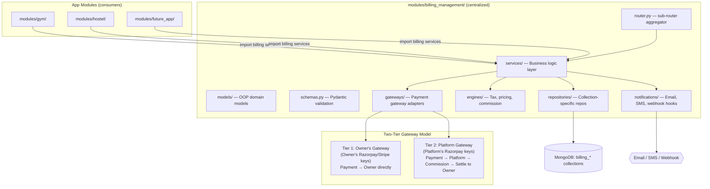
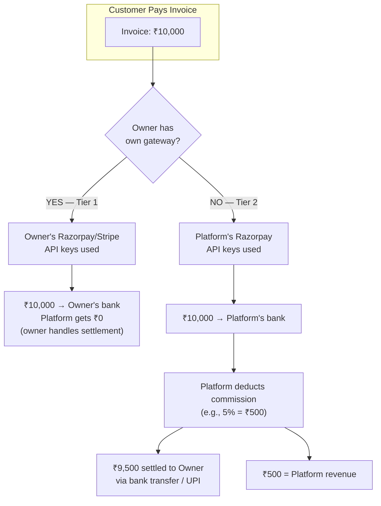
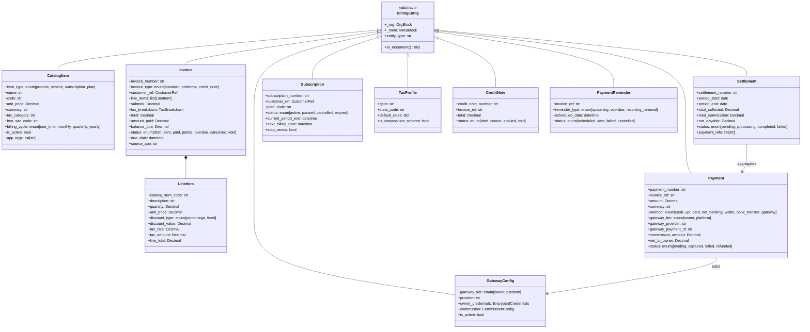

# Centralized Billing System — Implementation Plan (v2)

A centralized, **app-agnostic** billing engine for the multi-tenant workspace backend. Any app (Gym, Hostel, future apps) plugs into the same billing infrastructure via `app_code` from `OrgContext`. Supports dynamic invoicing, subscriptions, goods/services catalog, GST/tax, cash mode, **two-tier payment gateway ownership** (owner's own gateway vs. platform gateway with commission), payment links, recurring billing, reminders, and notifications.

---

## Architecture Overview



### How Apps Consume Billing

Each app module (Gym, Hostel, etc.) does NOT implement its own billing. Instead:

```python
# Inside modules/gym/router.py or modules/hostel/services/billing_service.py
from app.modules.billing_management.services.invoice_service import InvoiceService
from app.modules.billing_management.services.payment_service import PaymentService

# The billing service automatically scopes to the correct org + app via OrgContext
invoice_svc = InvoiceService(db, ctx)  # ctx.app_code = "myGym" or "myHostel"
invoice = await invoice_svc.create_invoice(customer_ref, line_items)
payment = await payment_svc.record_payment(invoice.invoice_number, amount, method="cash")
```

The `_org.app_code` field on every billing document ensures Gym invoices and Hostel invoices never mix, even within the same org.

---

### Why Separate Collections (Not `records`)?

| Reason | Detail |
|:---|:---|
| **Strict schemas** | Financial data needs typed fields (amounts as Decimal, dates, tax breakdowns) — not a generic `data` bag |
| **Dedicated indexes** | Billing queries (unpaid invoices, overdue, revenue aggregation, GST filing) need specialized compound indexes |
| **Regulatory compliance** | Financial records may need different retention policies and immutability |
| **Performance isolation** | High-volume billing aggregations won't compete with general CRUD on `records` |
| **Commission/settlement** | Platform commission tracking requires financial-grade atomicity |

**Collections:**

| Collection | Purpose |
|:---|:---|
| `billing_catalog` | Products, services, subscription plans — the "what you sell" |
| `billing_invoices` | Invoices / bills / proforma |
| `billing_payments` | Payment records (gateway, cash, bank transfer) |
| `billing_subscriptions` | Active/recurring subscription instances |
| `billing_credit_notes` | Refunds, credit adjustments |
| `billing_tax_profiles` | GST profiles, tax rate configs per org |
| `billing_reminders` | Scheduled payment reminders & notification log |
| `billing_gateway_configs` | ★ Per-org/per-app gateway credentials (owner's own keys) |
| `billing_settlements` | ★ Platform → owner commission & settlement ledger |
| `billing_sequences` | Billing-specific sequence counters |

> All collections share the `_org` + `_meta` audit structure from `OrgContext`, maintaining full multi-tenant isolation.

---

## ★ Two-Tier Payment Gateway Model

This is the core architectural differentiator. The platform supports two payment modes:



### Gateway Config Model

```python
# billing_gateway_configs collection — one document per org+app
{
    "_org": { "org_id": 5, "app_code": "myGym", ... },
    "_meta": { "entity_type": "gateway_config", ... },
    "data": {
        "gateway_tier": "owner",           # "owner" | "platform"
        "provider": "razorpay",            # "razorpay" | "stripe"

        # Only populated for tier "owner" — encrypted at rest
        "owner_credentials": {
            "key_id": "rzp_live_xxxxx",
            "key_secret": "encrypted:...",  # AES-encrypted
            "webhook_secret": "encrypted:..."
        },

        # Commission settings (only relevant for tier "platform")
        "commission": {
            "rate_type": "percentage",      # "percentage" | "fixed"
            "rate_value": 5.0,              # 5% or ₹50 fixed
            "min_commission": 10.0,         # Floor: minimum ₹10 per txn
            "max_commission": 5000.0,       # Cap: maximum ₹5000 per txn
        },

        "is_active": true,
        "verified_at": "2026-05-20T10:00:00Z"
    }
}
```

### Settlement Model

```python
# billing_settlements collection — tracks every platform → owner payout
{
    "_org": { "org_id": 5, "app_code": "myGym", ... },
    "_meta": { "entity_type": "settlement", ... },
    "data": {
        "settlement_number": "STL-001",
        "period_start": "2026-05-01",
        "period_end": "2026-05-31",

        # Money breakdown
        "total_collected": 50000.0,         # Total payments via platform gateway
        "total_commission": 2500.0,         # Platform's cut (5%)
        "total_refunds": 1000.0,            # Refunds during period
        "net_payable": 46500.0,             # What owner receives

        # Settlement execution
        "status": "pending",                # pending | processing | completed | failed
        "paid_via": "bank_transfer",        # bank_transfer | upi
        "paid_at": null,
        "reference_id": null,               # Bank txn reference

        # Linked payments
        "payment_refs": ["PAY-001", "PAY-002", "PAY-003"],
    }
}
```

---

## User Review Required

> [!IMPORTANT]
> **Gateway Credential Security**: Owner's Razorpay/Stripe API keys will be stored encrypted (AES-256) in MongoDB. The encryption key will be in environment variables. Is this acceptable, or do you need a dedicated secrets manager (AWS Secrets Manager, HashiCorp Vault)?

> [!IMPORTANT]
> **Settlement Automation**: Should settlements be:
> - (a) **Manual** — Admin reviews and triggers settlement payouts
> - (b) **Semi-automatic** — System calculates, admin approves, then auto-transfers
> - (c) **Fully automatic** — Scheduled payout on fixed dates (weekly/monthly)

> [!WARNING]
> **Existing Billing Migration**: Both the [Hostel billing](file:///d:/Development/saas_platform/apps/work_space/backend/app/modules/hostel/services/billing_service.py) and [Gym subscriptions](file:///d:/Development/saas_platform/apps/work_space/backend/app/modules/gym/router.py#L648-L787) have inline billing logic. After the centralized system is built, these should be migrated to use the billing module's services. Should this migration happen in this PR or a separate follow-up?

---

## Open Questions

> [!IMPORTANT]
> 1. **Commission Rate Scope**: Should the commission rate be configurable:
>    - (a) Per **platform** (same rate for all orgs), OR
>    - (b) Per **org** (different rate per customer), OR
>    - (c) Per **org + app** (Gym gets 5%, Hostel gets 3%)

> [!IMPORTANT]
> 2. **Invoice Numbering**: Use existing `APPCODE-INV-YYYYMM-NNNN` format, or custom financial-year format (e.g., `ORG/2026-27/001`)?

> [!IMPORTANT]
> 3. **Multi-Currency**: INR-only for now, or multi-currency from the start?

> [!IMPORTANT]
> 4. **Notification Channels for Phase 1**: Email, SMS, WhatsApp, or in-app only?

---

## Domain Model (OOP Design)



---

## Proposed Changes

### Module Structure

```text
app/modules/billing_management/
├── __init__.py
├── router.py                    # Aggregates sub-routers under /billing
├── schemas.py                   # Pydantic v2 models (strict typed)
├── constants.py                 # Entity types, status enums, defaults
│
├── models/                      # OOP domain models
│   ├── __init__.py
│   ├── base.py                  # BillingEntity abstract base
│   ├── catalog.py               # CatalogItem
│   ├── invoice.py               # Invoice + LineItem + CustomerRef
│   ├── payment.py               # Payment
│   ├── subscription.py          # Subscription
│   ├── tax_profile.py           # TaxProfile
│   ├── credit_note.py           # CreditNote
│   ├── reminder.py              # PaymentReminder
│   ├── gateway_config.py        # ★ GatewayConfig (owner vs platform)
│   └── settlement.py            # ★ Settlement (commission ledger)
│
├── repositories/                # Collection-specific repos
│   ├── __init__.py
│   ├── billing_repository.py    # Base billing repo (extends OrgRepository)
│   ├── catalog_repo.py          # billing_catalog
│   ├── invoice_repo.py          # billing_invoices
│   ├── payment_repo.py          # billing_payments
│   ├── subscription_repo.py     # billing_subscriptions
│   ├── credit_note_repo.py      # billing_credit_notes
│   ├── tax_profile_repo.py      # billing_tax_profiles
│   ├── reminder_repo.py         # billing_reminders
│   ├── gateway_config_repo.py   # ★ billing_gateway_configs
│   └── settlement_repo.py       # ★ billing_settlements
│
├── services/                    # Business logic
│   ├── __init__.py
│   ├── catalog_service.py       # CRUD for billable items
│   ├── invoice_service.py       # Invoice lifecycle
│   ├── payment_service.py       # Payment + gateway orchestration
│   ├── subscription_service.py  # Subscription lifecycle
│   ├── tax_service.py           # Tax profile mgmt + computation
│   ├── credit_note_service.py   # Refund/credit management
│   ├── reminder_service.py      # Reminder scheduling
│   ├── gateway_config_service.py # ★ Gateway credential mgmt
│   └── settlement_service.py    # ★ Commission calc + settlement
│
├── engines/                     # Pure computation (no I/O)
│   ├── __init__.py
│   ├── tax_engine.py            # GST: CGST/SGST/IGST calculation
│   ├── pricing_engine.py        # Discounts, proration, line totals
│   └── commission_engine.py     # ★ Commission calculation
│
├── gateways/                    # Payment gateway adapters
│   ├── __init__.py
│   ├── base_gateway.py          # Abstract gateway protocol
│   ├── gateway_factory.py       # ★ Resolves Tier1/Tier2 + provider
│   ├── razorpay_gateway.py      # Razorpay implementation
│   ├── stripe_gateway.py        # Stripe (placeholder)
│   └── cash_gateway.py          # Cash/offline — no-op gateway
│
├── notifications/               # Notification dispatch
│   ├── __init__.py
│   ├── base_notifier.py         # Abstract notifier
│   ├── email_notifier.py        # Email dispatch
│   └── in_app_notifier.py       # In-app notification records
│
├── routes/                      # Sub-routers (one per domain)
│   ├── __init__.py
│   ├── catalog_routes.py        # /billing/catalog/*
│   ├── invoice_routes.py        # /billing/invoices/*
│   ├── payment_routes.py        # /billing/payments/*
│   ├── subscription_routes.py   # /billing/subscriptions/*
│   ├── tax_routes.py            # /billing/tax/*
│   ├── credit_note_routes.py    # /billing/credit-notes/*
│   ├── reminder_routes.py       # /billing/reminders/*
│   ├── gateway_routes.py        # ★ /billing/gateway/* (config CRUD)
│   ├── settlement_routes.py     # ★ /billing/settlements/*
│   └── analytics_routes.py      # /billing/analytics/*
│
└── utils/
    ├── __init__.py
    ├── formatters.py            # Currency, date, GST formatters
    └── encryption.py            # ★ AES encrypt/decrypt for gateway keys
```

---

### Core Infrastructure

#### [NEW] [constants.py](file:///d:/Development/saas_platform/apps/work_space/backend/app/modules/billing_management/constants.py)
All entity types, status enums, tax codes, gateway tiers, and defaults as Python `StrEnum` classes.

Key enums:
```python
class GatewayTier(StrEnum):
    OWNER = "owner"        # Owner's own Razorpay/Stripe keys
    PLATFORM = "platform"  # Platform collects, takes commission

class PaymentMethod(StrEnum):
    CASH = "cash"
    UPI = "upi"
    CARD = "card"
    NET_BANKING = "net_banking"
    WALLET = "wallet"
    BANK_TRANSFER = "bank_transfer"
    GATEWAY = "gateway"    # Any gateway-mediated payment

class InvoiceStatus(StrEnum):
    DRAFT = "draft"
    SENT = "sent"
    PAID = "paid"
    PARTIAL = "partial"
    OVERDUE = "overdue"
    CANCELLED = "cancelled"
    VOID = "void"

class SettlementStatus(StrEnum):
    PENDING = "pending"
    PROCESSING = "processing"
    COMPLETED = "completed"
    FAILED = "failed"
```

#### [NEW] [models/base.py](file:///d:/Development/saas_platform/apps/work_space/backend/app/modules/billing_management/models/base.py)
Abstract `BillingEntity` base class that delegates `_org`, `_meta` building to `OrgContext`. All domain models inherit this.

#### [NEW] [schemas.py](file:///d:/Development/saas_platform/apps/work_space/backend/app/modules/billing_management/schemas.py)
Pydantic v2 strict models. Billing uses **typed schemas** (not dynamic sanitizer) because financial data needs field-level validation.

#### [NEW] [utils/encryption.py](file:///d:/Development/saas_platform/apps/work_space/backend/app/modules/billing_management/utils/encryption.py)
AES-256 encrypt/decrypt for gateway API keys stored in MongoDB. Encryption key from environment variable `BILLING_ENCRYPTION_KEY`.

---

### ★ Gateway Config & Commission

#### [NEW] [models/gateway_config.py](file:///d:/Development/saas_platform/apps/work_space/backend/app/modules/billing_management/models/gateway_config.py)
`GatewayConfig` model — per-org, per-app gateway credentials with commission settings.

#### [NEW] [models/settlement.py](file:///d:/Development/saas_platform/apps/work_space/backend/app/modules/billing_management/models/settlement.py)
`Settlement` model — tracks platform → owner money transfers with full breakdown.

#### [NEW] [engines/commission_engine.py](file:///d:/Development/saas_platform/apps/work_space/backend/app/modules/billing_management/engines/commission_engine.py)
Pure computation engine for commission:
```python
def calculate_commission(
    payment_amount: Decimal,
    rate_type: str,       # "percentage" | "fixed"
    rate_value: Decimal,  # 5.0% or ₹50
    min_commission: Decimal = Decimal("0"),
    max_commission: Decimal | None = None,
) -> CommissionResult:
    """Returns CommissionResult(commission, net_to_owner)"""
```

#### [NEW] [gateways/gateway_factory.py](file:///d:/Development/saas_platform/apps/work_space/backend/app/modules/billing_management/gateways/gateway_factory.py)
Factory that resolves the correct gateway instance based on the org's config:
```python
async def resolve_gateway(db, ctx: OrgContext) -> tuple[BaseGateway, GatewayTier]:
    """
    1. Look up billing_gateway_configs for this org + app
    2. If tier == "owner" → instantiate Razorpay with owner's keys
    3. If tier == "platform" → instantiate Razorpay with platform keys
    4. If no config → default to cash-only (CashGateway)
    """
```

#### [NEW] [services/gateway_config_service.py](file:///d:/Development/saas_platform/apps/work_space/backend/app/modules/billing_management/services/gateway_config_service.py)
- CRUD for gateway configurations
- Encrypt credentials before storage
- Validate gateway credentials by making a test API call
- One active config per org+app (upsert semantics)

#### [NEW] [services/settlement_service.py](file:///d:/Development/saas_platform/apps/work_space/backend/app/modules/billing_management/services/settlement_service.py)
- Generate settlement report for a period
- Aggregate all platform-tier payments, calculate total commission
- Create settlement record
- Mark as completed when admin confirms payout

#### [NEW] [routes/gateway_routes.py](file:///d:/Development/saas_platform/apps/work_space/backend/app/modules/billing_management/routes/gateway_routes.py)
- `POST /billing/gateway/config` — Set gateway config (owner keys OR platform tier)
- `GET /billing/gateway/config` — Get current config for this org+app
- `PUT /billing/gateway/config` — Update credentials/commission
- `POST /billing/gateway/config/verify` — Test gateway credentials
- `DELETE /billing/gateway/config` — Remove (falls back to cash-only)

#### [NEW] [routes/settlement_routes.py](file:///d:/Development/saas_platform/apps/work_space/backend/app/modules/billing_management/routes/settlement_routes.py)
- `GET /billing/settlements` — List settlements for org
- `POST /billing/settlements/generate` — Generate settlement for a period
- `GET /billing/settlements/{number}` — Settlement detail with linked payments
- `POST /billing/settlements/{number}/complete` — Mark as paid (admin)
- `GET /billing/settlements/summary` — Outstanding balance summary

---

### Catalog (Products / Services / Plans)

#### [NEW] [models/catalog.py](file:///d:/Development/saas_platform/apps/work_space/backend/app/modules/billing_management/models/catalog.py)
`CatalogItem` — anything billable. Includes `app_tags` field so items can be tagged for specific apps (e.g., `["myGym", "myHostel"]`) or shared across all apps.

#### [NEW] [repositories/catalog_repo.py](file:///d:/Development/saas_platform/apps/work_space/backend/app/modules/billing_management/repositories/catalog_repo.py)
#### [NEW] [services/catalog_service.py](file:///d:/Development/saas_platform/apps/work_space/backend/app/modules/billing_management/services/catalog_service.py)
#### [NEW] [routes/catalog_routes.py](file:///d:/Development/saas_platform/apps/work_space/backend/app/modules/billing_management/routes/catalog_routes.py)
- `POST /billing/catalog` — Create catalog item
- `GET /billing/catalog` — List with filters (type, active, app_tag)
- `GET /billing/catalog/{code}` — Get single
- `PUT /billing/catalog/{code}` — Update
- `DELETE /billing/catalog/{code}` — Soft-delete

---

### Tax Engine (GST)

#### [NEW] [models/tax_profile.py](file:///d:/Development/saas_platform/apps/work_space/backend/app/modules/billing_management/models/tax_profile.py)
#### [NEW] [engines/tax_engine.py](file:///d:/Development/saas_platform/apps/work_space/backend/app/modules/billing_management/engines/tax_engine.py)
GST computation:
- **Intra-state** → CGST (9%) + SGST (9%)
- **Inter-state** → IGST (18%)
- Configurable rates: standard 18%, food 5%, luxury 28%, exempt 0%

#### [NEW] [services/tax_service.py](file:///d:/Development/saas_platform/apps/work_space/backend/app/modules/billing_management/services/tax_service.py)
#### [NEW] [routes/tax_routes.py](file:///d:/Development/saas_platform/apps/work_space/backend/app/modules/billing_management/routes/tax_routes.py)
- `POST /billing/tax/profiles` — Create tax profile
- `GET /billing/tax/profiles` — List
- `PUT /billing/tax/profiles/{id}` — Update
- `POST /billing/tax/calculate` — Preview tax computation

---

### Invoicing

#### [NEW] [models/invoice.py](file:///d:/Development/saas_platform/apps/work_space/backend/app/modules/billing_management/models/invoice.py)
`Invoice` with `source_app` field — tracks which app generated this invoice. `CustomerRef` is a flexible reference (member_id for Gym, guest_id for Hostel, etc.).

```python
@dataclass
class CustomerRef:
    """Flexible customer reference — works with any app's entity."""
    ref_type: str      # "member", "guest", "tenant", "customer"
    ref_id: str        # "M-1", "G-42", etc.
    name: str          # Display name
    email: str = ""
    phone: str = ""
```

#### [NEW] [engines/pricing_engine.py](file:///d:/Development/saas_platform/apps/work_space/backend/app/modules/billing_management/engines/pricing_engine.py)
#### [NEW] [repositories/invoice_repo.py](file:///d:/Development/saas_platform/apps/work_space/backend/app/modules/billing_management/repositories/invoice_repo.py)
#### [NEW] [services/invoice_service.py](file:///d:/Development/saas_platform/apps/work_space/backend/app/modules/billing_management/services/invoice_service.py)

Invoice lifecycle — designed for cross-app use:
```python
class InvoiceService:
    async def create_invoice(
        self,
        customer_ref: CustomerRef,    # Flexible: Gym member, Hostel guest, etc.
        line_items: list[LineItemInput],
        due_date: date | None = None,
        notes: str = "",
    ) -> dict:
        """
        1. Resolve tax profile for this org
        2. Compute line totals via PricingEngine
        3. Compute taxes via TaxEngine
        4. Generate invoice number via sequence
        5. Insert into billing_invoices
        6. Schedule payment reminder if due_date is set
        """
```

#### [NEW] [routes/invoice_routes.py](file:///d:/Development/saas_platform/apps/work_space/backend/app/modules/billing_management/routes/invoice_routes.py)
- `POST /billing/invoices` — Create invoice
- `GET /billing/invoices` — List (filter: status, date range, customer, source_app)
- `GET /billing/invoices/{number}` — Get with payment history
- `PUT /billing/invoices/{number}` — Update (draft only)
- `POST /billing/invoices/{number}/send` — Mark as sent + notify
- `POST /billing/invoices/{number}/void` — Cancel/void

---

### Payments (with Two-Tier Gateway)

#### [NEW] [models/payment.py](file:///d:/Development/saas_platform/apps/work_space/backend/app/modules/billing_management/models/payment.py)
Payment model with gateway tier tracking:
```python
@dataclass
class PaymentData:
    payment_number: str
    invoice_ref: str
    amount: Decimal
    currency: str
    method: PaymentMethod          # cash, upi, card, gateway, etc.

    # Gateway details
    gateway_tier: GatewayTier      # "owner" | "platform"
    gateway_provider: str          # "razorpay" | "stripe" | ""
    gateway_payment_id: str        # Provider's payment ID
    gateway_order_id: str          # Provider's order ID

    # Commission (only for platform tier)
    commission_amount: Decimal     # Platform's cut
    net_to_owner: Decimal          # Amount owed to owner

    status: PaymentStatus
    payment_date: datetime
    notes: str
```

#### [NEW] [gateways/base_gateway.py](file:///d:/Development/saas_platform/apps/work_space/backend/app/modules/billing_management/gateways/base_gateway.py)
```python
class PaymentGateway(Protocol):
    async def create_order(self, amount: Decimal, currency: str, receipt: str, notes: dict) -> GatewayOrder
    async def verify_payment(self, payment_id: str, order_id: str, signature: str) -> bool
    async def create_payment_link(self, amount: Decimal, customer: CustomerRef, description: str, expiry_hours: int) -> PaymentLinkResult
    async def initiate_refund(self, payment_id: str, amount: Decimal) -> RefundResult
```

#### [NEW] [gateways/razorpay_gateway.py](file:///d:/Development/saas_platform/apps/work_space/backend/app/modules/billing_management/gateways/razorpay_gateway.py)
Razorpay implementation — accepts dynamic credentials (owner's or platform's).

#### [NEW] [gateways/cash_gateway.py](file:///d:/Development/saas_platform/apps/work_space/backend/app/modules/billing_management/gateways/cash_gateway.py)
No-op gateway for cash/offline. Returns success immediately.

#### [NEW] [services/payment_service.py](file:///d:/Development/saas_platform/apps/work_space/backend/app/modules/billing_management/services/payment_service.py)
Payment flow with commission:
```python
class PaymentService:
    async def record_payment(self, invoice_ref: str, amount: Decimal, method: str, **kwargs) -> dict:
        """
        1. Resolve gateway config for this org+app
        2. If method == "cash" → use CashGateway
        3. If method == "gateway":
            a. Resolve tier (owner vs platform) from gateway_config
            b. If tier == "platform" → calculate commission via CommissionEngine
            c. Create order via resolved gateway
        4. Insert payment record with commission fields
        5. Update invoice amount_paid / balance_due / status
        6. If tier == "platform" → track in settlement ledger
        """
```

#### [NEW] [routes/payment_routes.py](file:///d:/Development/saas_platform/apps/work_space/backend/app/modules/billing_management/routes/payment_routes.py)
- `POST /billing/payments` — Record payment (cash/manual)
- `POST /billing/payments/gateway/create-order` — Initiate gateway payment
- `POST /billing/payments/gateway/verify` — Verify gateway callback
- `POST /billing/payments/link` — Generate payment link
- `GET /billing/payments` — List (filter: method, status, gateway_tier)
- `GET /billing/payments/{number}` — Detail
- `POST /billing/payments/{number}/refund` — Initiate refund
- `POST /billing/payments/webhook` — Gateway webhook handler (Razorpay/Stripe)

---

### Subscriptions (Recurring)

#### [NEW] [models/subscription.py](file:///d:/Development/saas_platform/apps/work_space/backend/app/modules/billing_management/models/subscription.py)
#### [NEW] [services/subscription_service.py](file:///d:/Development/saas_platform/apps/work_space/backend/app/modules/billing_management/services/subscription_service.py)
#### [NEW] [routes/subscription_routes.py](file:///d:/Development/saas_platform/apps/work_space/backend/app/modules/billing_management/routes/subscription_routes.py)
- `POST /billing/subscriptions` — Create (auto-generates first invoice)
- `GET /billing/subscriptions` — List
- `POST /billing/subscriptions/{number}/renew` — Manual renewal
- `POST /billing/subscriptions/{number}/pause` — Pause
- `POST /billing/subscriptions/{number}/cancel` — Cancel
- `POST /billing/subscriptions/process-renewals` — Cron: process due renewals

---

### Credit Notes, Reminders, Analytics

#### [NEW] Credit note routes: `POST /billing/credit-notes`, `GET`, `POST /{number}/apply`
#### [NEW] Reminder routes: `GET /billing/reminders`, `POST /billing/reminders/process`, `PUT /{id}/cancel`
#### [NEW] Analytics routes:
- `GET /billing/analytics/revenue` — Revenue by period
- `GET /billing/analytics/outstanding` — Unpaid invoice summary
- `GET /billing/analytics/tax-summary` — GST filing report
- `GET /billing/analytics/commission` — ★ Platform commission report
- `GET /billing/analytics/settlements` — ★ Settlement status overview
- `GET /billing/analytics/kpis` — Dashboard KPIs (MRR, ARR, collection rate)

---

### Database & Indexes

#### [MODIFY] [database.py](file:///d:/Development/saas_platform/apps/work_space/backend/app/db/database.py)
Add billing-specific indexes in `_ensure_indexes()`:

```python
# ── Billing Indexes ─────────────────────────────────────────────────

# Invoices: overdue lookup, customer history
await db["billing_invoices"].create_index(
    [("_org.org_id", 1), ("data.status", 1), ("data.due_date", 1)],
    name="idx_bill_inv_status_due", background=True)
await db["billing_invoices"].create_index(
    [("_org.org_id", 1), ("data.invoice_number", 1)],
    name="idx_bill_inv_number", unique=True, background=True)
await db["billing_invoices"].create_index(
    [("_org.org_id", 1), ("data.customer_ref.ref_id", 1)],
    name="idx_bill_inv_customer", background=True)

# Payments: invoice lookup, gateway tier filtering
await db["billing_payments"].create_index(
    [("_org.org_id", 1), ("data.invoice_ref", 1)],
    name="idx_bill_pay_invoice", background=True)
await db["billing_payments"].create_index(
    [("_org.org_id", 1), ("data.gateway_tier", 1), ("data.status", 1)],
    name="idx_bill_pay_tier_status", background=True)

# Subscriptions: renewal processing
await db["billing_subscriptions"].create_index(
    [("_org.org_id", 1), ("data.status", 1), ("data.next_billing_date", 1)],
    name="idx_bill_sub_renewal", background=True)

# Gateway configs: one per org+app
await db["billing_gateway_configs"].create_index(
    [("_org.org_id", 1), ("_org.app_code", 1)],
    name="idx_bill_gw_org_app", unique=True, background=True)

# Settlements: period lookup
await db["billing_settlements"].create_index(
    [("_org.org_id", 1), ("data.status", 1)],
    name="idx_bill_stl_status", background=True)

# Reminders: scheduled processing
await db["billing_reminders"].create_index(
    [("data.status", 1), ("data.scheduled_date", 1)],
    name="idx_bill_rem_scheduled", background=True)

# Catalog: code lookup
await db["billing_catalog"].create_index(
    [("_org.org_id", 1), ("data.code", 1)],
    name="idx_bill_cat_code", unique=True, background=True)
```

---

### Sequence Tags

#### [MODIFY] [org_sequence.py](file:///d:/Development/saas_platform/apps/work_space/backend/app/db/org_sequence.py)
Add billing entity tags to `ENTITY_TAG_MAP`:

```python
"billing_catalog":      "CAT",
"billing_invoice":      "INV",
"billing_payment":      "PAY",
"billing_subscription": "BSB",
"billing_credit_note":  "CRN",
"billing_tax_profile":  "TAX",
"billing_reminder":     "RMD",
"billing_gateway":      "GWY",
"billing_settlement":   "STL",
```

---

### Router Registration

#### [MODIFY] [api_router.py](file:///d:/Development/saas_platform/apps/work_space/backend/app/api/v1/api_router.py)
```python
from app.modules.billing_management.router import router as billing_router
api_router.include_router(billing_router, prefix="/billing", tags=["billing"])
```

---

### Config Changes

#### [MODIFY] [config.py](file:///d:/Development/saas_platform/apps/work_space/backend/app/core/config.py)
```python
# ── Billing — Gateway ──────────────────────────────────────────────
# Platform's own gateway credentials (used for Tier 2 payments)
PLATFORM_RAZORPAY_KEY_ID: str = ""
PLATFORM_RAZORPAY_KEY_SECRET: str = ""
PLATFORM_STRIPE_SECRET_KEY: str = ""

# Encryption key for storing owner's gateway credentials
BILLING_ENCRYPTION_KEY: str = ""   # AES-256 key (32 bytes, base64 encoded)

# ── Billing — Commission Defaults ──────────────────────────────────
PLATFORM_DEFAULT_COMMISSION_RATE: float = 5.0  # 5% default
PLATFORM_MIN_COMMISSION: float = 10.0          # ₹10 minimum per txn

# ── Billing — Notifications ───────────────────────────────────────
BILLING_SMTP_HOST: str = ""
BILLING_SMTP_PORT: int = 587
BILLING_SMTP_USER: str = ""
BILLING_SMTP_PASS: str = ""
BILLING_FROM_EMAIL: str = "billing@yourdomain.com"

# ── Billing — Defaults ────────────────────────────────────────────
BILLING_DEFAULT_CURRENCY: str = "INR"
BILLING_DEFAULT_TAX_RATE: float = 18.0
BILLING_PAYMENT_LINK_EXPIRY_HOURS: int = 72
BILLING_REMINDER_DAYS_BEFORE: int = 3
```

---

### Dependencies

#### [MODIFY] [pyproject.toml](file:///d:/Development/saas_platform/apps/work_space/backend/pyproject.toml)
```toml
"razorpay>=1.4.2",          # Razorpay SDK (Phase 2)
"jinja2>=3.1.0",            # Notification templates
"cryptography>=44.0.0",     # AES encryption for gateway keys
```

---

## Phased Delivery

### Phase 1 — Foundation + Cash Billing ✦ This PR
- [ ] Module scaffolding (all directories, `__init__.py` files)
- [ ] Constants & enums (`constants.py`)
- [ ] Domain models (all entity types including GatewayConfig, Settlement)
- [ ] Pydantic schemas (`schemas.py`)
- [ ] `BillingRepository` base (extends OrgRepository for billing collections)
- [ ] All collection-specific repositories
- [ ] Tax engine (GST: CGST/SGST/IGST computation)
- [ ] Pricing engine (discounts, line totals)
- [ ] Commission engine (percentage/fixed calculation)
- [ ] Tax profiles CRUD
- [ ] Catalog CRUD (products, services, plans)
- [ ] Invoice CRUD with full tax computation
- [ ] Payment recording (**cash mode only**)
- [ ] Invoice status lifecycle (draft → sent → partial → paid)
- [ ] Database indexes for all billing collections
- [ ] Sequence tag registration
- [ ] Router registration in `api_router.py`

### Phase 2 — Gateway + Commission + Payment Links
- [ ] Encryption utility for gateway credentials
- [ ] Gateway config CRUD (owner's keys / platform tier)
- [ ] Gateway factory (tier resolution)
- [ ] Razorpay gateway adapter (orders, verify, payment links)
- [ ] Cash gateway adapter
- [ ] Payment service with two-tier flow + commission tracking
- [ ] Webhook handler for async payment confirmations
- [ ] Payment link generation and tracking

### Phase 3 — Settlements
- [ ] Settlement generation (aggregate payments, compute commission)
- [ ] Settlement CRUD + status lifecycle
- [ ] Commission analytics (platform revenue, per-org breakdown)
- [ ] Settlement summary reports

### Phase 4 — Subscriptions & Recurring Billing
- [ ] Subscription lifecycle (activate → renew → pause → cancel)
- [ ] Auto-invoice generation on renewal
- [ ] Recurring payment processing endpoint (cron-callable)
- [ ] Proration for mid-cycle changes

### Phase 5 — Notifications, Reminders & Analytics
- [ ] Notification abstraction + email notifier
- [ ] Payment reminder scheduling (before-due, overdue, renewal)
- [ ] Reminder processing endpoint
- [ ] Revenue analytics (MRR, ARR, collection rate)
- [ ] GST summary report
- [ ] Dashboard KPIs

### Phase 6 — Migration (Separate PR)
- [ ] Migrate [Hostel billing](file:///d:/Development/saas_platform/apps/work_space/backend/app/modules/hostel/services/billing_service.py) to use centralized billing services
- [ ] Migrate [Gym subscription billing](file:///d:/Development/saas_platform/apps/work_space/backend/app/modules/gym/router.py#L648-L787) to use centralized billing services
- [ ] Deprecate inline billing code

---

## Verification Plan

### Automated Tests

```powershell
cd apps\work_space\backend
uv sync
uv run uvicorn app.main:app --port 8001 --reload
```

- Server starts without import errors
- All billing routes appear in Swagger at `http://localhost:8001/docs`
- API testing for Phase 1:
  1. Create tax profile → verify GST computation
  2. Create catalog items (product, service, subscription_plan)
  3. Create invoice with multiple line items → verify tax + total computation
  4. Record cash payment → verify invoice status updates
  5. Test org isolation: Org A cannot see Org B's billing data
  6. Test app isolation: Gym invoices don't appear in Hostel queries

### Manual Verification
- Full billing flow: Catalog → Invoice → Payment → Status change
- Commission calculation: verify math for percentage/fixed rates
- Gateway config: store and retrieve (verify encryption works)
