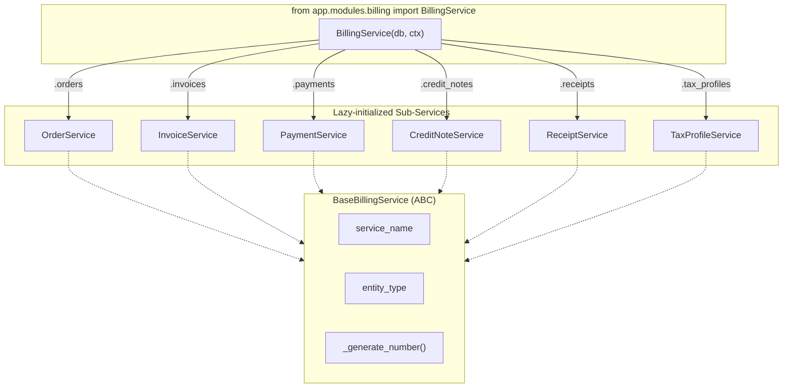

# Billing Service Redesign — Walkthrough

## What Changed

Redesigned the billing module from a flat service layer into a class-based, ABC-driven billing SDK. Domain apps now import billing like a third-party library.

---

## Architecture



## Files Created (16 new files)

| File | Purpose |
|:---|:---|
| [base.py](file:///d:/Development/saas_platform/apps/work_space/backend/app/modules/billing/services/base.py) | `BaseBillingService` ABC — shared db/ctx/logging/numbering |
| [sequence_helpers.py](file:///d:/Development/saas_platform/apps/work_space/backend/app/modules/billing/utils/sequence_helpers.py) | `indian_financial_year()` + `generate_billing_number()` |
| [order_doc.py](file:///d:/Development/saas_platform/apps/work_space/backend/app/modules/billing/documents/order_doc.py) | `OrderDoc` — pre-invoice staging with `SourceRefEmbed` |
| [receipt_doc.py](file:///d:/Development/saas_platform/apps/work_space/backend/app/modules/billing/documents/receipt_doc.py) | `ReceiptDoc` — auto-generated proof of payment |
| [order_service.py](file:///d:/Development/saas_platform/apps/work_space/backend/app/modules/billing/services/order_service.py) | `OrderService` — create, confirm (auto-invoice), cancel |
| [credit_note_service.py](file:///d:/Development/saas_platform/apps/work_space/backend/app/modules/billing/services/credit_note_service.py) | `CreditNoteService` — issue, apply, void refunds |
| [receipt_service.py](file:///d:/Development/saas_platform/apps/work_space/backend/app/modules/billing/services/receipt_service.py) | `ReceiptService` — read-only + internal _generate_receipt() |
| [tax_profile_service.py](file:///d:/Development/saas_platform/apps/work_space/backend/app/modules/billing/services/tax_profile_service.py) | `TaxProfileService` — renamed from TaxService |
| [service.py](file:///d:/Development/saas_platform/apps/work_space/backend/app/modules/billing/service.py) | `BillingService` facade — composes all 6 sub-services |
| [order_schemas.py](file:///d:/Development/saas_platform/apps/work_space/backend/app/modules/billing/schemas/order_schemas.py) | `CreateOrderInput`, `OrderResponse` |
| [credit_note_schemas.py](file:///d:/Development/saas_platform/apps/work_space/backend/app/modules/billing/schemas/credit_note_schemas.py) | `IssueCreditNoteInput`, `CreditNoteResponse` |
| [receipt_schemas.py](file:///d:/Development/saas_platform/apps/work_space/backend/app/modules/billing/schemas/receipt_schemas.py) | `ReceiptResponse` (no input — auto-generated) |
| [gateways/base.py](file:///d:/Development/saas_platform/apps/work_space/backend/app/modules/billing/gateways/base.py) | `PaymentGateway` ABC — future Razorpay/Stripe/Cashfree |

## Files Modified (9 files)

| File | Changes |
|:---|:---|
| [constants.py](file:///d:/Development/saas_platform/apps/work_space/backend/app/modules/billing/constants.py) | Added `OrderStatus`, `ReceiptStatus`, `CreditNoteStatus`. Removed 10+ deleted enums |
| [invoice_service.py](file:///d:/Development/saas_platform/apps/work_space/backend/app/modules/billing/services/invoice_service.py) | Inherits ABC, renamed methods, added `create_from_order()` |
| [payment_service.py](file:///d:/Development/saas_platform/apps/work_space/backend/app/modules/billing/services/payment_service.py) | Inherits ABC, auto-receipt on full payment, auto-order completion |
| [payment_doc.py](file:///d:/Development/saas_platform/apps/work_space/backend/app/modules/billing/documents/payment_doc.py) | Removed `GatewayProvider`/`GatewayTier` imports |
| [tax_engine.py](file:///d:/Development/saas_platform/apps/work_space/backend/app/modules/billing/engines/tax_engine.py) | `TaxBreakdown` moved inline (frozen dataclass) |
| [database.py](file:///d:/Development/saas_platform/apps/work_space/backend/app/db/database.py) | Beanie registration: -4 deleted, +2 new docs |
| [invoice_routes.py](file:///d:/Development/saas_platform/apps/work_space/backend/app/modules/billing/routes/invoice_routes.py) | Updated to renamed methods |
| [payment_routes.py](file:///d:/Development/saas_platform/apps/work_space/backend/app/modules/billing/routes/payment_routes.py) | Updated to renamed methods |
| [tax_routes.py](file:///d:/Development/saas_platform/apps/work_space/backend/app/modules/billing/routes/tax_routes.py) | `TaxService` → `TaxProfileService` |
| [gym/router.py](file:///d:/Development/saas_platform/apps/work_space/backend/app/modules/gym/router.py) | SDK imports: `from app.modules.billing import BillingService, ...` |

## Files Deleted (8 files)

| Deleted | Reason |
|:---|:---|
| `subscription_doc.py` | Subscriptions belong in domain modules |
| `reminder_doc.py` | No notification infra |
| `gateway_config_doc.py` | Phase 2 gateway |
| `settlement_doc.py` | Phase 2 settlement |
| `commission_engine.py` | Phase 2 gateway |
| `tax_service.py` | Replaced by `tax_profile_service.py` |
| `models/base.py` | `TaxBreakdown` moved to engine, others replaced by Beanie |
| `models/__init__.py` | Directory removed |

## Verification Results

| Check | Result |
|:---|:---|
| SDK imports (`from app.modules.billing import ...`) | ✅ Pass |
| ABC inheritance (all 6 services) | ✅ Pass |
| Beanie documents (6 collections) | ✅ Pass |
| Pricing engine (pure function) | ✅ Pass |
| Tax engine + TaxBreakdown | ✅ Pass |
| Gateway ABC (4 abstract methods) | ✅ Pass |
| Gym router imports | ✅ Pass |
| Full module import chain | ✅ Pass |

## SDK Usage Example

```python
from app.modules.billing import (
    BillingService, CreateOrderInput, CreateInvoiceInput,
    RecordPaymentInput, IssueCreditNoteInput,
    ServiceLineItem, CustomerRefSchema,
)

billing = BillingService(db, ctx)

# Full lifecycle
order = await billing.orders.create(order_input)
order, invoice = await billing.orders.confirm(order.order_number)
invoice = await billing.invoices.send(invoice.invoice_number)
payment = await billing.payments.record(payment_input)
# → Receipt auto-generated, order auto-completed

# Refund
cn = await billing.credit_notes.issue(cn_input)
cn = await billing.credit_notes.apply(cn.credit_note_number)

# Tax
profile = await billing.tax_profiles.create({...})
preview = billing.tax_profiles.preview(items, gstin, pos)
```
